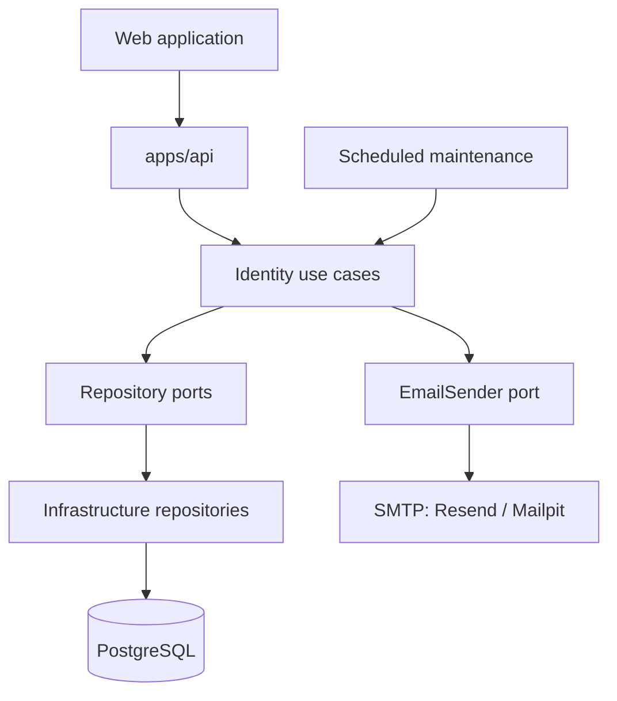

# Identity and Authentication Design

Roadmap tasks 005 and 006, API only.

Web integration remains part of tasks 006.1 and 006.2. The external identity management named in task 006 is out of scope, as listed under Non-goals. [ADR 0004](../technical/adr/0004-passwordless-email-authentication.md) records the decisions in this design.

## Intent

Every personal health record stored by Scibiom must belong to an identifiable account and an isolated workspace. This delivery establishes the identity and authentication foundation required by subsequent product capabilities.

Users can create an account, authenticate using a one-time email code, maintain a secure session, retrieve their account information, sign out and delete their account.

The implementation must be secure, transactionally consistent and straightforward to operate without introducing infrastructure for capabilities that do not yet exist.

## Goals

- Passwordless registration and authentication using a six-digit email code.
- Automatic account and personal workspace creation on first successful authentication.
- Opaque, server-side sessions stored in PostgreSQL.
- Secure cookie-based authentication.
- A shared `Actor` representation for authenticated use cases.
- Account retrieval, sign-out and account deletion.
- Protection against account enumeration, brute-force attacks and credential leakage.
- Automated cleanup of expired authentication records.
- Integration tests against real PostgreSQL.

## Non-goals

- Web interface implementation.
- Password-based authentication.
- OAuth, external identity providers, passkeys and multi-factor authentication.
- Email address changes.
- Session management endpoints for individual devices.
- Workspace memberships, organizations and invitations.
- Generic sudo mode or privilege elevation infrastructure.
- Transactional outbox and domain event dispatch.
- Background task queues and workflow orchestration.
- Valkey or Redis.
- Tenant row-level security policies, which arrive with the first tenant-owned tables.
- AWS deployment and infrastructure as code.

## Architectural Constraints

Existing repository conventions, package boundaries and applicable ADRs remain in effect unless explicitly superseded by this design.

- `apps/api` owns HTTP transport and application composition.
- `packages/core` owns domain models, use cases and ports.
- `packages/infrastructure` owns persistence and external service implementations.
- Core depends only on the Python standard library.
- Bounded contexts do not import each other.
- Each bounded context owns its PostgreSQL schema.
- Database migrations execute through `scibiom_owner`.
- Application queries execute through `scibiom_app`.
- Runtime processes must not have database ownership or migration privileges.
- The existing monorepo scaffolding and internal package organization remain unchanged.

## Architectural Decisions


| Concern                     | Decision                                              |
| --------------------------- | ----------------------------------------------------- |
| Architecture                | Modular monolith                                      |
| Identity and authentication | Single `identity` bounded context                     |
| Database                    | PostgreSQL, hosted on AWS RDS in production           |
| Authentication              | In-house passwordless email codes                     |
| Sessions                    | Opaque server-side sessions                           |
| Session transport           | Secure HttpOnly cookie                                |
| Rate limiting               | Per code and per email, computed from challenge rows  |
| Email delivery              | Synchronous SMTP call                                 |
| Production email            | SMTP with implicit TLS to Resend                      |
| Local email                 | SMTP to Mailpit                                       |
| Account deletion            | Typed email confirmation and transactional hard deletion |
| Maintenance                 | One plain `DELETE` command, manual or scheduled       |
| Background task queue       | Deferred                                              |
| Event infrastructure        | Deferred                                              |


These decisions minimize operational dependencies while preserving the boundaries needed for future extensions.

## Bounded Context

The `identity` bounded context owns accounts, personal workspaces, authentication challenges and sessions.

Authentication is a capability within identity rather than an independent bounded context. Account creation, credential verification and session management currently share transactional requirements and closely related invariants.

Other bounded contexts must not depend on authentication mechanisms, session tokens or email addresses. They receive an authenticated `Actor` containing the identifiers required to execute their own use cases.



## Account and Workspace

An account represents a registered individual.

Each account owns exactly one personal workspace. The workspace identifier is created together with the account and remains stable throughout its lifetime.

The workspace is the ownership boundary for future personal health information, documents, conversations and other tenant-owned resources.

For this delivery, the workspace identifier is stored directly on the account. A separate workspace table is unnecessary until workspaces acquire independent attributes, memberships or lifecycle requirements.

Account IDs and workspace IDs use UUIDv7.

## Authentication

### Request a code

`POST /v1/auth/codes`

```json
{
  "email": "ana@example.com"
}
```

The use case:

1. Normalizes and validates the email address.
2. Takes the per-email lock described under Transaction Management.
3. Checks the resend cooldown and the hourly email limit.
4. Invalidates previous active sign-in challenges for that address.
5. Generates a cryptographically secure six-digit code.
6. Persists the challenge and its expiration.
7. Commits the transaction.
8. Sends the code through the configured email provider.

Successful requests return `202 Accepted` with an empty body, regardless of whether the account already exists.

Rate-limited requests must not reveal account existence. The cooldown and the hourly limit both return the same `202` response without sending another code.

No account is created until the code has been successfully verified.

### Verify a code

`POST /v1/auth/sessions`

```json
{
  "email": "ana@example.com",
  "code": "482913"
}
```

The use case executes within a single database transaction:

1. Takes the per-email lock.
2. Retrieves the active sign-in challenge.
3. Validates its expiration and remaining attempts.
4. Verifies the submitted code using constant-time comparison.
5. Consumes the challenge on success.
6. Finds or creates the account and its personal workspace.
7. Creates a new session.
8. Commits the transaction.

The API returns `204 No Content` and sets the session cookie after the transaction succeeds.

An incorrect code decrements the remaining attempts. The use case commits those changes and then returns the generic authentication error, so a failed attempt is never rolled back.

Expired, invalid, exhausted and previously consumed challenges produce a generic authentication error.

### Authentication challenge policy


| Property                                | Value                 |
| --------------------------------------- | --------------------- |
| Code length                   | Six digits            |
| Validity                      | Five minutes          |
| Maximum verification attempts | Three per challenge   |
| Resend cooldown               | 60 seconds            |
| Maximum issuances per email   | Five per hour         |


Code generation uses `secrets`.

Codes are never persisted in plaintext. Each challenge stores an HMAC-SHA256 computed with the identity secret as key over a canonical representation of the challenge identifier and code.

Verification uses `hmac.compare_digest`.

Challenge issuance and verification must be concurrency-safe. PostgreSQL locking must prevent parallel requests from bypassing limits or consuming the same challenge more than once.

Three attempts per code and five codes per hour per email allow at most 15 guesses per hour against one million possible codes, so these two limits alone make brute force negligible.

## Sessions

Sessions are opaque credentials backed by PostgreSQL.

A session token consists of 32 cryptographically random bytes encoded for safe cookie transport.

The database stores only the SHA-256 hash of the token. The original token is returned exclusively through the session cookie.

### Session policy


| Property            | Value                 |
| ------------------- | --------------------- |
| Token entropy       | 256 bits              |
| Lifetime            | Fixed 14 days         |
| Storage             | PostgreSQL            |
| Revocation          | Session row deletion  |


A session is never renewed, and the person signs in again when it expires.

Session expiration and revocation are enforced on every authenticated request. Revoking a session deletes its row, so a revoked session is indistinguishable from a missing one and needs no retention rule.

Multiple concurrent sessions per account are supported by the data model. Device management endpoints are outside the scope of this delivery.

### Cookie configuration

Production cookie:

```http
Set-Cookie: __Host-scibiom_session=<token>;
  Secure;
  HttpOnly;
  SameSite=Strict;
  Path=/;
  Max-Age=1209600
```

The cookie must not define a `Domain` attribute.

Local and test environments may omit the `Secure` attribute and `__Host-` prefix to support plain HTTP development, and use the cookie name `scibiom_session`.

Staging and production environments must use HTTPS and the production cookie.

Local development serves the web app and the API on `localhost`, because browsers treat `localhost` and `127.0.0.1` as different sites and would not send a `SameSite=Strict` cookie between them.

### Session resolution

For every authenticated request, the API:

1. Extracts the session token from the cookie.
2. Hashes the token.
3. Retrieves the corresponding session.
4. Rejects missing or expired sessions.
5. Resolves the associated account.
6. Constructs an authenticated `Actor`.

The `Actor` contains:

```python
@dataclass(frozen=True)
class Actor:
    account_id: UUID
    workspace_id: UUID
```

The `Actor` is shared through the existing core kernel.

It represents an authenticated identity. Resource-level authorization remains the responsibility of the use case handling the requested resource.

## Account Operations

### Retrieve the current account

`GET /v1/me`

Returns the authenticated account's information.

```json
{
  "id": "account-uuid",
  "workspace_id": "workspace-uuid",
  "email": "ana@example.com",
  "created_at": "2026-11-24T12:00:00Z"
}
```

The account's email address is exposed only through explicitly authorized account operations.

### Sign out

`DELETE /v1/auth/sessions/current`

Deletes the current session row and clears the session cookie.

The operation is idempotent. An already deleted or missing session does not prevent cookie removal.

Returns `204 No Content`.

### Delete account

`POST /v1/me/deletion`

```json
{
  "email": "ana@example.com"
}
```

The person confirms the deletion by typing the account's email address. The request is already authenticated by the session cookie, so no further email code is required.

The deletion use case executes within a single PostgreSQL transaction:

1. Reads the account's email address and takes the per-email lock.
2. Rejects the request with `422` (`RuleViolationError`) when the submitted address, once normalized, differs from the account's address, and deletes nothing.
3. Locks the account.
4. Verifies that the current session still exists and has not expired.
5. Deletes every authentication challenge for the email address, including sign-in challenges that have no account.
6. Deletes the account, which cascades to its sessions.
7. Commits the transaction.

The API clears the session cookie and returns `204 No Content`.

Deletion is permanent. There is no grace period or asynchronous purge workflow in this delivery.

Account creation, session creation and deletion all take the per-email lock first, so a sign-in racing a deletion runs strictly before or after it. A sign-in that runs after finds its challenge deleted and fails, so it can neither leave an orphaned session nor recreate the account.

This implementation is valid while identity is the only context storing account-owned information. Before introducing medical records or other persistent user-owned resources, the deletion use case must be extended to cover those resources.

## Data Model

### `identity.accounts`

```text
id                  uuid, primary key
workspace_id        uuid, unique, not null
email               text, unique, not null
created_at          timestamptz, not null
```

Email addresses are trimmed and normalized to lowercase under the application's email identity policy.

Provider-specific normalization rules are not applied.

### `identity.auth_challenges`

```text
id                  uuid, primary key
email               text, not null
code_mac            bytea, not null
attempts_left       smallint, not null
created_at          timestamptz, not null
expires_at          timestamptz, not null
consumed_at         timestamptz, nullable
invalidated_at      timestamptz, nullable
```

Challenges are only for signing in and have no foreign keys, because a challenge exists before its account does.

Indexes support lookup by `(email, created_at)` and by `(expires_at)`. A partial unique index on `(email)` where `consumed_at IS NULL AND invalidated_at IS NULL` allows at most one active challenge per email address.

Database constraints prevent invalid attempt counts and inconsistent challenge states, so a challenge cannot be both consumed and invalidated.

### `identity.sessions`

```text
id                  uuid, primary key
account_id          uuid, foreign key, not null, on delete cascade
token_hash          bytea, unique, not null
created_at          timestamptz, not null
expires_at          timestamptz, not null
```

Sessions reference accounts through a foreign key within the identity schema, and deleting an account deletes its sessions.

Indexes on `account_id` and `expires_at` support account-level revocation and expiration cleanup.

## Transaction Management

Each state-changing use case defines its transaction boundary explicitly.

The existing persistence infrastructure provides transaction management. No generic cross-context transaction coordinator or distributed Unit of Work is introduced.

The following operations require atomic database transactions:

- Authentication challenge issuance and invalidation.
- Authentication challenge consumption.
- Account, workspace and session creation.
- Session revocation.
- Account deletion.

Email delivery occurs outside database transactions. Database locks must not be held while waiting for an external provider.

Repository implementations use database constraints and row-level locking to enforce invariants rather than relying exclusively on application-level checks.

Every transaction that reads or changes an email address's challenges or account first takes a transaction-scoped advisory lock with `pg_advisory_xact_lock(hashtextextended(<normalized email>, 0))`, and only then locks rows, in the order challenges, account, sessions. Serializing on one lock per email gives every flow the same acquisition order, so issuance, verification and deletion cannot deadlock one another. It also enforces the cooldown and hourly limits when no challenge row exists yet to lock. A hash collision only serializes two unrelated addresses, which is harmless.

Session resolution and sign-out touch only the session row and do not take the email lock.

## Rate Limiting

Limiting applies only per code and per email, and PostgreSQL computes it from the challenge rows. Each code allows three verification attempts, a new code cannot be issued within 60 seconds of the previous one, and an email address receives at most five codes per hour. Exceeding either issuance limit silently returns the same `202` without sending, so the response reveals nothing about the address.

The limits are evaluated under the per-email lock, so concurrent requests cannot exceed them. No counter table is needed, and the cooldown and the hourly limit act as a sliding window over the challenge rows.

When PostgreSQL is unavailable, authentication operations fail rather than bypassing security controls.

## Email Delivery

Email delivery is implemented through the existing infrastructure integration boundary.

The core defines an `EmailSender` port.

Implementations:

- SMTP with implicit TLS, using Resend in production.
- SMTP with Mailpit for local development.
- In-memory fake for unit tests.

Emails contain the authentication code, expiration information and a notice to ignore unsolicited requests.

Email delivery uses plain-text messages for this delivery.

Provider calls must have explicit timeouts.

Delivery either succeeds or it does not. A provider failure of any kind returns a generic `503 Service Unavailable` and the challenge stays, so it still counts toward the cooldown and the hourly limit, a retry inside the cooldown is suppressed and the code is never resent automatically.

A sending domain must be verified before production authentication can be made available to external users.

No email queue is introduced.

## Maintenance

An idempotent maintenance use case runs one plain `DELETE` for each of:

- Authentication challenges that expired more than 24 hours ago.
- Expired sessions.

Maintenance is exposed through a command that can be executed manually in local environments and through a scheduler in production.

No continuously running worker, task queue or event dispatcher is required for this delivery.

## Security

### Account enumeration

Public authentication responses must not disclose whether an email address belongs to an existing account.

Known and unknown email addresses follow the same challenge issuance path.

Registration and authentication are distinguished internally only after successful code verification.

Error responses must not disclose whether a particular challenge, account or session exists.

### Cross-site request forgery

A `POST`, `PUT`, `PATCH` or `DELETE` request whose `Origin` header is not on the allowlist is rejected with `403 Forbidden`, including on the public authentication endpoints, where it prevents login CSRF. A request without an `Origin` header is accepted, because browsers always send one on these methods, so its absence means a non-browser client that holds no victim's cookie.

CORS permits credentials only for explicitly configured origins.

Cookie-based authentication is protected through:

- Origin validation.
- `SameSite=Strict`.
- `Secure` cookies in staging and production.
- Explicit CORS configuration.

The eventual web and API deployment must use a compatible same-site configuration.

### Sensitive information

Authentication codes, raw session tokens, cookie headers and email addresses must not appear in application logs, exception reports or tracing attributes.

Raw session tokens may appear only in the intended cookie transport.

Email addresses may appear in authorized account responses and the email delivery integration where required.

User input and provider error bodies must not be logged without sanitization.

Authenticated account responses must use `Cache-Control: no-store`.

### Authentication assurance

Email-based authentication proves control of an email inbox. It does not provide independent multi-factor authentication or establish a person's verified real-world identity.

This delivery is intended for development and controlled product validation.

Authentication assurance, account recovery and applicable privacy and security requirements must be reviewed before Scibiom accepts real medical information from external users.

## Repository Layout

The existing monorepo scaffolding remains unchanged.

The identity capability is implemented within the current domain, use case, port and infrastructure conventions.

```text
packages/core/src/scibiom_core/
  kernel/
    clock.py
    access.py
  identity/
    domain/
    use_cases/
    ports/

packages/infrastructure/src/scibiom_infrastructure/
  database/
    tables/
      identity/
    repositories/
      identity/
    migrations/
  email/

apps/api/src/scibiom_api/
  routes/
    auth.py
    me.py
  transport/
```

Existing packages, application directories, integrations and unrelated modules are not removed or reorganized.

No worker application is created, because identity and authentication need no asynchronous processing.

The maintenance command is wired through an existing application entry point or command convention rather than introducing a new application or package.

## Configuration

Required settings:


| Setting                    | Purpose                       |
| -------------------------- | ----------------------------- |
| Database URL               | PostgreSQL connection         |
| Identity secret            | HMAC key for authentication codes |
| SMTP host and port         | Resend in production, Mailpit locally |
| SMTP credentials and TLS   | Required in staging and production |
| Sender address             | Authentication email sender   |
| Allowed origins            | CORS and origin validation    |
| Environment                | Local, test, staging or production |


The identity secret is the only secret to manage, and it is used directly as the code HMAC key. Secrets must be validated at startup and must not have insecure production defaults.

Authentication policy values remain named domain constants unless a concrete requirement justifies runtime configuration.

Local Compose configuration requires PostgreSQL and Mailpit.

No new Valkey dependency is introduced.

## API Contract


| Method | Endpoint                    | Authentication             |
| ------ | --------------------------- | -------------------------- |
| POST   | `/v1/auth/codes`            | Public                     |
| POST   | `/v1/auth/sessions`         | Public                     |
| DELETE | `/v1/auth/sessions/current` | Session cookie, if present |
| GET    | `/v1/me`                    | Required                   |
| POST   | `/v1/me/deletion`           | Required, typed email      |


Endpoints use the existing request validation and RFC 9457 error representation. This delivery introduces the `/v1` path prefix, and adds kernel errors for authentication failures (`401`) and unavailable dependencies (`503`), next to the existing `RuleViolationError` (`422`), mapped by the existing error handlers. A rejected origin (`403`) is decided in transport and never reaches a use case.

## Testing

### Domain and use case tests

Cover:

- Email normalization.
- Code generation and expiration.
- Verification attempt exhaustion.
- Cooldown and hourly issuance suppression.
- Session expiration.
- Account creation.
- Account deletion and email confirmation mismatch.
- Provider failure handling.

Use deterministic clocks and in-memory implementations of ports where appropriate.

### Integration tests

Run against real PostgreSQL and verify:

- Concurrent wrong codes spend exactly the attempts of the challenge.
- Concurrent right codes create exactly one session and account.
- Session revocation.
- Account deletion without orphaned credentials.
- Idempotent maintenance execution.
- Database role restrictions.

Concurrency tests must use independent database transactions.

### API tests

Verify:

- Successful passwordless registration and authentication.
- Generic responses for invalid credentials.
- Cookie attributes and expiration.
- Origin validation.
- Authenticated account retrieval.
- Sign-out and cookie removal.
- Account deletion confirmed by the typed email address.
- Sanitization of sensitive information.
- Prevention of authenticated response caching.

## Implementation Plan

### Slice 1 - Identity persistence

Implement account, challenge and session models, database migrations and repository implementations.

**Acceptance criterion:** identity data can be persisted and retrieved with database-enforced constraints.

### Slice 2 - Passwordless authentication

Implement challenge issuance, email delivery, verification and transactional account creation.

**Acceptance criterion:** a new or existing user can authenticate using a code delivered through Mailpit.

### Slice 3 - Authenticated API

Implement session cookies, session resolution, the shared `Actor`, origin validation, account retrieval and sign-out.

**Acceptance criterion:** an authenticated user can retrieve their account, and a revoked session cannot access protected endpoints.

### Slice 4 - Account deletion

Implement transactional account deletion confirmed by the typed email address.

**Acceptance criterion:** a user can permanently delete their account after confirming their email address, leaving no associated identity credentials.

### Slice 5 - Operational readiness

Implement the maintenance command and the concurrency tests.

**Acceptance criterion:** the authentication capability satisfies its documented security and consistency invariants.

## Deferred Capabilities


| Capability                      | Introduction criteria                                              |
| ------------------------------- | ------------------------------------------------------------------ |
| Separate authentication context | Independent lifecycle or integration requirements                  |
| Valkey                          | Measured database contention or session throughput requirements    |
| Procrastinate                   | Actual asynchronous processing requirements                        |
| Transactional outbox            | Business changes requiring reliable asynchronous delivery          |
| Cross-context deletion          | Additional contexts storing account-owned information              |
| Sudo mode                       | Multiple sensitive operations requiring reusable verification      |
| Email changes                   | Account management requirements                                    |
| Session management API          | Device-level account management requirements                       |
| Workspace memberships           | Shared or organizational workspaces                                |
| Stronger authentication         | Before external users entrust the product with medical information |

### Deliberately not built

- **IP and failed-verification rate limits.** Per-code attempts and per-email issuance already hold brute force to 15 guesses per hour, and IP limits mainly protect a sender's reputation against email bombing, which matters once the product has traffic.
- **Free retry after a confirmed delivery failure.** Delivery is either sent or not, so the extra state for telling failures apart is not worth it for a flow the user can simply retry after the cooldown.
- **Fresh email verification before deletion.** Typing the email address confirms intent, and an extra code would need challenge purposes and session binding for an app that holds only test data.
- **Sliding session renewal.** A fixed 14-day lifetime needs no idle or absolute limits and is easy to reason about, and signing in again is cheap.
- **Batched maintenance.** The tables are small enough that one plain `DELETE` per table is safe, and batching returns when volume justifies it.
- **Security events.** Structured events belong to the dedicated audit logging capability, so building a second mechanism here would duplicate it.


## Documentation Changes

ADR 0004 records the decisions in this design, which are a single identity context, passwordless email codes, opaque server-side sessions, PostgreSQL-backed challenges with per-code and per-email limits, and AWS RDS hosting. ADR 0003 describes accounts looked up by normalized email.

`AGENTS.md` lists the `email/` infrastructure package. `docs/technical/ARCHITECTURE.md` describes the identity context and the authenticated request path once they exist, and `docs/technical/database.dbml` gains each identity table in the same change as its migration.

The roadmap marks tasks 005 and 006 complete when this delivery is done.

Valkey, Procrastinate and a transactional outbox have no ADR, and each gets one only when its introduction criteria under Deferred Capabilities are met.

Existing architectural conventions and repository scaffolding remain unchanged.

## Definition of Done

The delivery is complete when a person can securely register, authenticate, maintain a session, retrieve their account, sign out and delete their account through the API.

Authentication limits and session invariants must hold under concurrent requests.

The application must operate with PostgreSQL and an email provider without requiring a cache server, continuously running worker, task queue or event infrastructure.

All unit, integration and API tests pass.

## Subtasks

Each subtask is one reviewable change that passes `make check` on its own. Subtasks within a slice run in order, and a slice starts when the previous one is merged.

### Slice 1 - Identity persistence

- [x] **1.1 Kernel primitives.** Add `Clock` and a system clock in `kernel/clock.py` and `Actor` in `kernel/access.py`. Add `AuthenticationError` and `UnavailableError` to `kernel/errors.py` beside `RuleViolationError` and map them to `401` and `503` in `transport/error_handlers.py`. Done when unit tests cover each mapping.
- [x] **1.2 Identity domain.** Add the `Email` value object with trimming, lowercasing and validation, the `Account`, `AuthChallenge` and `Session` models, and the policy values those models use as named constants. Done when domain tests cover normalization, expiry and attempt exhaustion.
- [x] **1.3 Identity migration.** Create the `identity` schema with the `scibiom_app` grants, and the `accounts`, `auth_challenges` and `sessions` tables with their foreign keys, check constraints and indexes. Pass the identity metadata to `env.py` and add the tables to `database.dbml`. Done when `make migrate` succeeds and integration tests prove each constraint rejects invalid rows.
- [x] **1.4 Repositories.** Declare the repository ports and the transaction port with the per-email lock in `core/identity/ports`, and implement them with SQLAlchemy in `repositories/identity/`. Done when integration tests against Postgres cover every repository method and the advisory lock blocks a second transaction on the same email.

### Slice 2 - Passwordless authentication

- [x] **2.1 Settings and local services.** The identity secret is in `ApiSettings`, required everywhere and validated at startup, `.env.example` lists it, and `VITE_SCIBIOM_API_URL` points at `http://localhost:8000`. Settings tests reject a missing or short secret.
- [x] **2.2 Email delivery.** The `EmailSender` port reports delivery as sent or failed, one SMTP adapter with explicit timeouts and optional implicit TLS and login serves Resend and Mailpit, and Mailpit runs in `compose.yaml`. The adapter delivers to Mailpit in an integration test, and its TLS selection and login are unit tested.
- [x] **2.3 Request a code.** The issuance use case takes the per-email lock, applies the cooldown and hourly limits with silent suppression, invalidates earlier codes, stores the HMAC and answers `503` when delivery fails. Use case tests cover suppression, delivery failure, and unknown and known emails producing identical outcomes.
- [x] **2.4 Verify a code.** The verification use case compares the code in constant time, commits attempt decrements, consumes the challenge, creates the account and workspace when needed and creates the session. Use case tests cover success for new and existing accounts and every generic failure path.
- [x] **2.5 Authentication routes.** The `/v1` router serves `POST /v1/auth/codes` and `POST /v1/auth/sessions`, the session cookie writer sets a 14-day `Max-Age`, and the OpenAPI contract is regenerated. An API test signs in with a code read from the fake sender and receives a cookie with the configured attributes.

### Slice 3 - Authenticated API

- [x] **3.1 Session resolution.** The `ResolveSession` use case checks expiry and builds the `Actor`, and the `ActorDep` FastAPI dependency reads the cookie and calls it. Tests cover missing and expired sessions.
- [x] **3.2 Origin and CORS.** The origin middleware rejects unsafe methods from origins off the allowlist, and CORS allows `POST` and `DELETE` with credentials for configured origins. API tests cover allowed, disallowed and absent `Origin` headers.
- [ ] **3.3 Account and sign-out routes.** Add `GET /v1/me` with `Cache-Control: no-store` and `DELETE /v1/auth/sessions/current`. Done when an API test proves a signed-out session can no longer read `/v1/me` and the cookie is cleared.

### Slice 4 - Account deletion

- [ ] **4.1 Delete the account.** Implement the deletion use case under the per-email lock, which rejects an email that differs from the account's, and `POST /v1/me/deletion` with `{"email": ...}`, clearing the cookie. Done when an integration test proves no account, session or challenge row remains for the email and an API test proves a mismatched email deletes nothing.

### Slice 5 - Operational readiness

- [ ] **5.1 Maintenance command.** Implement the idempotent maintenance use case as one plain `DELETE` of expired challenges and sessions, and expose it as a `scibiom-maintenance` script in `apps/api`. Done when an integration test runs it twice with the same result.
- [ ] **5.2 Concurrency tests.** Add two integration tests with independent transactions, concurrent wrong codes that spend exactly the attempts and concurrent right codes that create exactly one session and account. Done when both pass repeatedly under `make test-integration`.
- [ ] **5.3 Documentation.** Update `ARCHITECTURE.md` with the identity context and the authenticated request path, document the maintenance command and mark roadmap tasks 005 and 006 complete. Done when the docs describe the code as merged.
