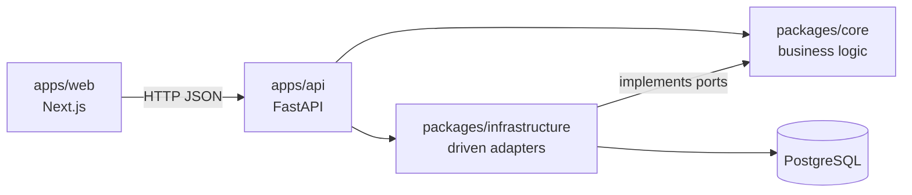

# Architecture

Scibiom is a modular monolith whose business rules live in one framework-free package, so that REST today, and MCP and agent tools later, run the same use cases without any entry point carrying rules of its own. [ADR 0001](adr/0001-modular-monolith.md) records why this shape was chosen. This page describes the shape as it exists now, and it changes with the code.

## System map

Imports run in one direction, from `scibiom_api` to `scibiom_infrastructure` to `scibiom_core`, and Import Linter fails CI when a lower layer reaches up. The core also may not import FastAPI, Starlette, SQLAlchemy, Pydantic or any other framework, and infrastructure may not import anything HTTP related. `AGENTS.md` holds the full rule list.

## Packages

| Package | Responsibility today |
|---|---|
| `apps/web` | Browser UI that calls the API directly with TanStack Query. Its types are generated from `apps/api/openapi.json`, so the two sides cannot drift. See `apps/web/AGENTS.md`. |
| `apps/api` | Composition root and REST adapter. It builds the container, installs middleware and maps domain errors to HTTP problem details. |
| `packages/infrastructure` | Postgres engine and sessions, migrations, the database readiness probe, logging and request correlation. |
| `packages/core` | The `kernel` package, which holds the domain error types and the readiness port. No bounded context exists yet. |

## Repository

All code lives in one repository with two workspaces. The root `pyproject.toml` defines a uv workspace whose members are `apps/api`, `packages/core` and `packages/infrastructure`, so the Python packages import each other as ordinary dependencies and share one lockfile. The root `pnpm-workspace.yaml` holds `apps/web`. One Makefile drives both toolchains, and CI runs `make check` and the web build on every pull request and every push to `main`, so a change that crosses the API contract and the generated web types is verified together.

## Request path

A request passes through four middleware layers in this order. `RequestIdMiddleware` assigns the correlation ID, `AccessLogMiddleware` logs the outcome without bodies or query strings, `CORSMiddleware` applies the explicit origin list, and `UnhandledErrorMiddleware` turns any uncaught exception into a generic problem response. The route then calls a use case and returns a wire schema.

Only the health routes exist so far, and they call `evaluate_readiness` from the kernel with the probes the container supplies. Once a bounded context lands, its routes will call that context's use cases in the same way, and the route file will stay a thin translation between HTTP and the use case.

## Ports and adapters

The readiness check is the one working example of the pattern. The kernel defines the `ReadinessCheck` protocol, `DatabaseReadinessCheck` in infrastructure implements it, and `build_container` in `apps/api/bootstrap/container.py` wires the two together. The core never learns that Postgres exists, which is why its tests need no database.

The container is built once in the FastAPI lifespan and disposed on shutdown. Dependencies reach handlers through FastAPI dependencies, and there are no module-level singletons.

## Errors

Expected business failures are `DomainError` subclasses in the kernel, and each carries a stable `code`. The API maps `NotFoundError` to 404, `ConflictError` to 409 and `RuleViolationError` to 422, and renders every error as an RFC 9457 problem with the request ID and no internal detail.

## Data

Each bounded context will own one Postgres schema, with no foreign keys across schemas, UUIDv7 identifiers generated in Python, and a `workspace_id` on tenant-owned rows. The API connects as `scibiom_app` and migrations as `scibiom_owner`. The current schema is in [database.dbml](database.dbml), and the role model is explained in [database.md](database.md).

## Where to read next

- [adr/](adr/) holds the decisions that are costly to reverse, with the alternatives that were rejected.
- The other pages in [this folder](.) explain how a mechanism works today.
- [roadmap.md](../roadmap.md) lists the planned capabilities in order.
