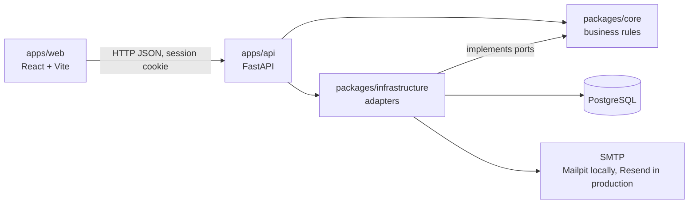

# Architecture

Scibiom is a modular monolith whose business rules live in one framework-free package, so that REST today, and MCP and agent tools later, run the same use cases without any entry point carrying rules of its own. [ADR 0001](adr/0001-modular-monolith.md) records why. This page is the map of the code and the rules it follows, and a change to either updates it in the same change.

## System map



## Repository layout

```text
apps/
  api/src/scibiom_api/
    bootstrap/               settings, container, lifespan, logging setup
    routes/                  one module per resource, thin translation to use cases
    transport/               middleware, dependencies, cookies, problem details
    main.py                  app factory and the OpenAPI contract
  web/                       React SPA, rules in apps/web/AGENTS.md
packages/
  core/src/scibiom_core/
    kernel/                  primitives more than one context needs
    <context>/
      domain/                models and values with their rules
      ports/                 one module per port
      use_cases/             one module per use case
  infrastructure/src/scibiom_infrastructure/
    database/
      tables/<context>/      one module per table
      repositories/<context>/ one module per repository
      migrations/
    email/                   SMTP delivery
    observability/
docs/
  specs/                     designs for the owner to review before building
  technical/                 this page, ADRs, database.dbml, BACKLOG.md
tools/openapi-codegen/       generates the web API types
docker/postgres/initdb/      creates the database roles on first start
```

A folder exists only when it groups several modules, and no folder is created ahead of its code. New apps and packages (`worker`, `mcp`, `ai`, `integrations`) are created by the first capability that needs them. `identity` is the only context today.

Tests live in each package's `tests/` and mirror its source folders, as the Testing section of `AGENTS.md` describes.

## Dependency rules

1. Apps import packages, packages never import apps.
2. `core` imports only the standard library. `infrastructure` may import `core` but never FastAPI, Starlette or Uvicorn.
3. Bounded contexts never import each other, in core or in infrastructure's `tables/` and `repositories/`. A context that needs another's data declares a port, and the composition root wires it.
4. Inside a context, `domain` imports only `kernel`, `ports` import `domain`, and `use_cases` import `domain` and `ports`.
5. No Python module or package is named `utils`, `helpers`, `common`, `misc`, `shared` or `types`.

Import Linter and `make arch` enforce rules 1, 2, 4 and 5, with one layers contract per context. Rule 3 gets its contract when the second context arrives.

## Where types live

| Kind | Location |
|---|---|
| Domain types | `core/<context>/domain`, private to the context |
| Use case inputs and outputs | `core/<context>/use_cases` |
| Wire schemas (Pydantic) | the app that serves them |
| Persistence rows | `infrastructure/database/tables/<context>/` |
| Frontend API types | generated from `apps/api/openapi.json`, never hand-written |

## Request path

A request passes through five middleware layers in this order. `RequestIdMiddleware` assigns the correlation ID, `AccessLogMiddleware` logs the outcome without bodies or query strings, `OriginMiddleware` rejects unsafe methods from origins off the allowlist, `CORSMiddleware` applies that same allowlist with credentials, and `UnhandledErrorMiddleware` turns any uncaught exception into a generic problem response.

The route then parses the body, calls one use case and writes the response, and nothing else. A route that needs a signed-in person depends on `ActorDep`, which reads the session cookie, resolves it through the `ResolveSession` use case.

The container is built once in the FastAPI lifespan and disposed on shutdown, and it is the only place where adapters are wired to ports. Dependencies reach handlers through FastAPI dependencies, never through module-level singletons. The OpenAPI contract comes from the routes alone, so exporting it needs no settings.

## Errors

Expected failures are `DomainError` subclasses in the kernel, each with a stable `code`. The API maps `RuleViolationError` to 422, `AuthenticationError` to 401 and `UnavailableError` to 503, and renders every error as an RFC 9457 problem with the request ID and no internal detail.

## Data

Each context owns one Postgres schema, foreign keys never cross schemas, IDs are UUIDv7 from `uuid.uuid7()`, and tenant-owned rows carry `workspace_id`. The current schema is in [database.dbml](database.dbml), which every table change updates.

Two roles connect to the same database, as [ADR 0002](adr/0002-least-privilege-database-roles.md) decides.

| Role | Setting | Rights |
|---|---|---|
| `scibiom_app` | `SCIBIOM_DATABASE__URL` | Reads and writes rows granted to it, nothing else |
| `scibiom_owner` | `SCIBIOM_MIGRATION_DATABASE_URL` | Owns every schema and runs migrations |

Database access is an allowlist. The migration that creates a context schema grants the application role access in the same migration, and nothing grants it globally.

```sql
GRANT USAGE ON SCHEMA <context> TO scibiom_app;
ALTER DEFAULT PRIVILEGES IN SCHEMA <context>
  GRANT SELECT, INSERT, UPDATE, DELETE ON TABLES TO scibiom_app;
```

A context that needs less grants less, such as `INSERT` only for an append-only audit log, and `test_schema_privileges_integration.py` fails CI for any schema without these grants.

Migrations are hand-reviewed Alembic revisions created with `make migration name=<what>`. They run with `lock_timeout` from `SCIBIOM_MIGRATION_LOCK_TIMEOUT_MS` (5000 by default), so a migration that cannot take its lock fails instead of queueing requests behind it. Offline migrations are not supported. `make migration-check` fails on drift between the tables and the database, but Alembic does not compare check constraints, so those live only in the migration and in the schema integration tests.

Locally, `docker/postgres/initdb/10-roles.sh` creates both roles the first time the container starts, and `make db-reset` runs it again on a fresh volume. Query a local database as `scibiom_app` when debugging, because the owner bypasses the restrictions the API runs under.
