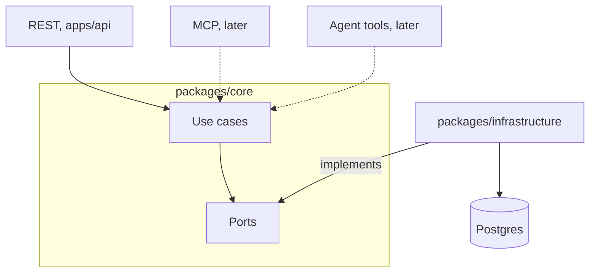

# 1. Modular monolith with a framework-free core

## Status

Accepted

## Date

2026-11-24

## Context

Scibiom will hold sensitive health information and serve several entry points. The web app needs a REST API now, and an MCP server, agent tools and durable workflows are expected later. Each entry point must apply the same rules, because a rule enforced in the REST layer but skipped in an agent tool would be a privacy defect and not a style issue.

The team is small and the domain model is still being discovered, so any boundary drawn now is a guess, and a wrong guess is expensive to move once several packages depend on it.

## Decision

The backend is one deployable modular monolith organised as ports and adapters. All business logic lives in `packages/core`, which imports only the Python standard library and is split into one subpackage per bounded context plus a `kernel` for shared primitives. Driven adapters live in `packages/infrastructure`, and each application is a composition root and a thin driving adapter with no business rules. [ARCHITECTURE.md](../ARCHITECTURE.md) describes the resulting layout.

Everything lives in one repository, as a uv workspace for the Python packages and a pnpm workspace for the web app. A change that spans the API, the core and the generated web types then lands in one commit and one CI run, which suits a small team that moves all three together.

Each bounded context owns one Postgres schema, foreign keys never cross schemas, and identifiers are UUIDv7 values generated in Python, which keeps them sortable by creation time and independent of the database. Import Linter enforces the layering in CI.

## Alternatives considered

Creating horizontal packages such as `ai` and `integrations` up front was rejected because empty packages become dumping grounds, where code lands in whichever package exists and not where its meaning belongs.

One vertical package per feature, each with its own HTTP layer, was rejected because every module would grow one adapter per entry point. With REST, MCP and agent tools, each module would become a small application with its own copy of the wiring, and the rules would drift between copies.

Microservices were rejected because the boundaries are not yet known and a small team would pay for network calls, distributed transactions and separate deployments before they bought any isolation.

## Consequences

A feature touches its context in `packages/core`, its adapters in `packages/infrastructure` and a thin route in `apps/api`. Business rules cannot diverge between entry points because none of them contain rules, and core tests need no server or database because use cases receive in-memory fakes of their ports.

Extracting a context into its own service stays possible, since contexts talk to each other only through ports and each owns its schema.

The cost is discipline. Contracts for context boundaries arrive with the first context, and until then review carries those rules. Cross-context queries must go through use cases and never through SQL joins.

Technology that no capability needs yet, such as Temporal, pgvector and an MCP app, is added with the first feature that uses it and listed in the [roadmap](../../roadmap.md). Redis, Kubernetes and microservices are not planned.
