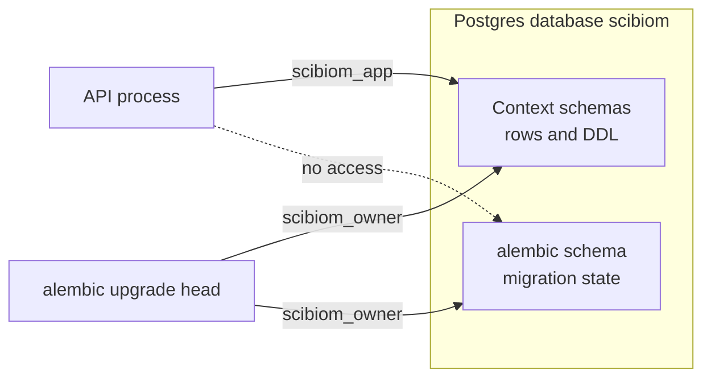

# 2. Separate database roles for schema ownership and application access

## Status

Accepted

## Date

2026-11-24

## Context

The API process handles every request, so a bug or compromise in its code runs with whatever database privileges it holds. Migrations need far more, because they create schemas and tables. If both share one role, a SQL injection or a compromised dependency could drop a table or rewrite the privilege model.

PostgreSQL row-level security will isolate tenants once Identity & Workspace exists, and table owners bypass it unless the table forces it. If the application connected as the owner, its policies would silently stop applying, so the isolation guarantee would depend on who connects and not on the policy.

## Decision

The API connects as `scibiom_app`, which can read and write rows but cannot create, alter or drop schema objects. Migrations run as `scibiom_owner`, which owns the database and every context schema, and the API never receives its credentials. Migration state lives in a schema the application role cannot touch, so it can neither read nor rewrite which migrations have run. [database.md](../database.md) describes the wiring.

The API can reach only the rows, and only the owner role can change a schema or touch migration state.

## Alternatives considered

A single role that owns the schema and serves the API was the simplest option. It was rejected because application code could then change the schema, and the API would be exempt from row-level security, which would make tenant isolation unenforceable.

## Consequences

A compromised or buggy API cannot alter or drop schema objects, and the two credentials rotate independently.

The application role gets access as an allowlist. Each migration that creates a context schema grants `scibiom_app` usage on it and default privileges on its future tables, and nothing grants access globally. A new schema therefore starts closed, and a context such as an audit log can grant `INSERT` alone. Migration state stays out of reach because nothing ever grants it. A forgotten grant would only surface as a runtime permission error, so an integration test fails CI for any schema the application role cannot use.

Anyone debugging locally must pick the role deliberately, because using the owner role for ad hoc queries reintroduces the bypass this decision exists to prevent.
