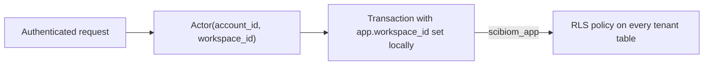

# 3. Personal workspaces as the tenancy boundary

## Status

Proposed

## Date

2026-11-24

## Context

Every row that holds personal health data must belong to exactly one owner, and PostgreSQL row-level security must enforce that ownership, because a single missing `WHERE` clause in application code would otherwise expose one person's records to another. The contract already requires a `workspace_id` on tenant-owned rows, so the open question is what a workspace is.

The roadmap scopes the first release to individual accounts and lists organisations, memberships, administrative hierarchies and family accounts as out of scope. Capability 08 adds sharing, but as resource-specific, read-only access delegated to a healthcare professional, not as joining someone else's workspace.

## Decision

Each account owns exactly one personal workspace, created together with the account. The `workspace_id` is a UUIDv7 stored on `identity.accounts`, and there is no memberships table and no workspaces table until a capability needs workspace attributes.

The API resolves every authenticated request to an `Actor` holding the account ID and the workspace ID. Each database transaction then runs `set_config('app.workspace_id', <id>, true)`, which scopes the value to that transaction, and every tenant table enables and forces row-level security with one policy.

```sql
ALTER TABLE <context>.<table> ENABLE ROW LEVEL SECURITY;
ALTER TABLE <context>.<table> FORCE ROW LEVEL SECURITY;
CREATE POLICY workspace_isolation ON <context>.<table>
  USING (workspace_id = nullif(current_setting('app.workspace_id', true), '')::uuid)
  WITH CHECK (workspace_id = nullif(current_setting('app.workspace_id', true), '')::uuid);
```

A transaction that never sets the workspace sees no rows and can write none, so forgetting the setting fails closed.



`identity.accounts` is the one exception. Authentication looks an account up by its external subject before the workspace is known, so that table is not scoped by workspace. It holds only the account ID, the workspace ID, the external subject and timestamps, never health data, and only the identity use cases read it.

## Alternatives considered

Using the account ID as the tenant key was the simplest option. It was rejected because it merges who is acting with whose data is touched, and delegated sharing in capability 08 needs exactly those two to differ, a professional's account reading a patient's workspace.

A workspace and membership model was rejected because the roadmap excludes organisations and families, and every policy would need a join through memberships that no current capability uses.

Filtering by owner in application code alone was rejected because isolation would then depend on every query being written correctly, while row-level security keeps it in force even when one query is wrong.

A schema or database per tenant was rejected because migrations, grants and connection pools would multiply with every user.

## Consequences

Every migration that creates a tenant table enables and forces row-level security and adds the policy above in the same migration. An integration test connected as `scibiom_app` must prove that one workspace cannot read or write another's rows, and it lands with the first tenant table.

The workspace setting is transaction-local, so a pooled connection cannot carry one person's workspace into the next request. Background jobs and agent tools must set the workspace explicitly through the same session factory, because they have no HTTP request to derive it from.

Delegated sharing will need its own access path, such as a grant table that policies consult, which is decided when capability 08 starts. Adding organisations or families later would replace the one-account-one-workspace rule and requires a new ADR.
