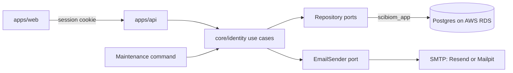

# 4. Passwordless email authentication with server-side sessions

## Status

Accepted

## Date

2026-11-24

## Context

Every personal health record must belong to an identifiable account and an isolated workspace, so capability 01 needs registration, sign-in, sessions, sign-out and account deletion before any other context can store user data. ADR 0003 already fixes the ownership model, one account with one personal workspace, and leaves open how a person proves who they are.

Three constraints shape the answer. ADR 0001 keeps every business rule in `packages/core`, so authentication rules cannot live in a provider's dashboard or SDK. ADR 0002 has the API connect as `scibiom_app` and migrations as `scibiom_owner`, so whatever stores identity data must respect that split. The roadmap also forbids architectural complexity that no current capability demands, which rules out adding a cache server, a task queue or an event bus only to support sign-in.

Account creation, code verification and session creation share one invariant, because a verified code must produce exactly one account and one session or nothing at all. Keeping all three in the same Postgres transaction is the simplest way to hold that invariant under concurrent requests.

## Decision

A single `identity` bounded context owns accounts, personal workspaces, authentication challenges and sessions, all in the `identity` Postgres schema. Authentication is a capability inside identity, not a separate context, because its invariants are bound to account creation.

People authenticate with a short-lived code sent to their email address, and there are no passwords. A verified code creates the account and its workspace on first use, so registration and sign-in follow the same public path and the API never reveals whether an address is registered.

Sessions are opaque random tokens kept server-side in Postgres and carried in an `HttpOnly`, `SameSite=Strict` cookie, so sign-out, deletion and expiry take effect on the next request. Other contexts never see tokens or email addresses, and receive an `Actor` holding the account ID and the workspace ID.

Codes and session tokens are stored only as keyed or plain hashes. Attempts and issuance limits are computed in Postgres from the challenge rows, beside the data they protect. Email goes out through an `EmailSender` port over SMTP after the transaction commits, Resend in production and Mailpit locally. Production Postgres is hosted on AWS RDS.

## Alternatives considered

A hosted authentication provider such as Supabase Auth, Clerk or Auth0 was rejected because accounts and sessions would live outside the transaction that creates the workspace, the provider would become a second place where identity rules live, and Scibiom would add an operational dependency that this delivery can avoid.

Password authentication was rejected because it brings hash storage, reset flows and credential stuffing defences, while email codes prove the same inbox control that a password reset would rely on anyway.

Self-contained signed tokens such as JWTs were rejected because sign-out, deletion and expiry must take effect on the next request, and a signed token stays valid until it expires unless the server checks state anyway.

Valkey for sessions and limits was rejected for now because Postgres already handles the expected load, and a second datastore would add operations work without a measured need. It returns as an option if database contention is observed.

An email queue was rejected because no other capability needs background processing yet, and a synchronous call with an explicit timeout gives the user an immediate error when delivery fails.

Per-IP and failed-verification rate limits, fresh email verification before account deletion and sliding session renewal were considered and deferred, because a portfolio app with test data does not face the threats they answer, while per-code attempts and per-email issuance limits already bound guessing.

## Consequences

Scibiom now stores email addresses, which are personal data, so they must stay out of logs, exception reports and tracing attributes, and only account responses and the email adapter may handle them. Scibiom also owns the whole authentication security surface, including enumeration resistance, brute-force limits, secret validation at startup and concurrency safety, and the integration tests against real Postgres are what prove those properties.

Email codes prove control of an inbox and nothing more. Stronger authentication and an account recovery review are required before Scibiom accepts real medical information from external users.

Account deletion is a hard delete inside one transaction, which is correct only while identity is the sole context holding account-owned data. The first context that stores user resources must extend deletion to cover them.

Production sign-in depends on a verified sending domain in Resend. The RDS region follows the target jurisdiction, which is still an open decision, and provisioning it is outside this delivery. This decision does not make Scibiom compliant with any regulation.
