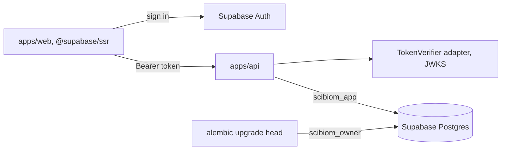

# 4. Supabase for managed Postgres and authentication

## Status

Accepted

## Date

2026-11-24

## Context

Capability 01 needs registration, sign-in, session handling and external identities. Building them by hand means storing password hashes, running reset and verification flows and adding multi-factor authentication, which is security-critical work that a solo developer would also have to keep patched. The system also needs a managed Postgres host with backups and point-in-time recovery before any deployed environment exists.

Two earlier decisions constrain the choice. ADR 0001 keeps every business rule in `packages/core`, so no provider may become a second place where rules live. ADR 0002 has the API connect as `scibiom_app` and migrations as `scibiom_owner`, so the host must allow custom roles and keep row-level security in force for the application role.

## Decision

Supabase hosts the production Postgres database, and Supabase Auth handles sign-up, sign-in, sessions, OAuth providers and multi-factor authentication. Scibiom uses nothing else from Supabase until a capability needs it, and file storage is decided with capability 06.

The web app uses `@supabase/ssr` only for authentication, confined to `modules/identity`, and sends the access token to the API as a bearer token. The API verifies the token's asymmetric signature against the project's JWKS endpoint through an adapter in `packages/infrastructure` that implements a `TokenVerifier` port declared in `core/identity`. Core receives only the external subject, and `identity.accounts` maps that subject to Scibiom's own UUIDv7 account ID. Scibiom never stores passwords and never copies the email address out of Supabase Auth.

The Data API (PostgREST), GraphQL, Realtime and Edge Functions stay disabled, so the database is reachable only through the API and migrations. `scibiom_owner` and `scibiom_app` are created as custom roles. The API connects through the Supavisor pooler in transaction mode with psycopg's `prepare_threshold=None`, because pooled transactions cannot reuse server-side prepared statements, while migrations use a direct or session-mode connection.

Local development and CI keep the plain Postgres container from `compose.yaml`, and tests replace the token verifier with an in-memory fake. Exercising the real sign-in flow locally uses a separate Supabase development project.

## Alternatives considered

Building authentication in-house was rejected because the security surface is large and none of it is Scibiom's product.

A dedicated identity provider such as Clerk, Auth0 or WorkOS was rejected because it adds a second third party that holds account data and sign-in metadata, while Supabase Auth keeps identities in the same database whose host already sees all data.

Using Supabase as the whole backend, with the browser querying tables through `supabase.from()` and policies based on `auth.uid()`, was rejected because requests would bypass `packages/core`, rules would spread across SQL policies and frontend code, and agent tools and MCP could not reuse them.

Self-managed Postgres on a virtual machine was rejected because backups, recovery, upgrades and monitoring would become operational work before the product has users.

## Consequences

Supabase is coupled to Scibiom in three places, the token verifier adapter, the web identity module and the database host. Changing provider touches those and the migration of accounts, not core or any other context.

Supabase becomes part of the trust boundary, because as the host it can technically read all data. The project region follows the target jurisdiction, which is still an open decision. Processing real health data will require a data processing agreement, and a business associate agreement if United States users are in scope, on a paid plan, plus the assessments the roadmap requires. This decision does not make Scibiom compliant with any regulation.

Accounts in Supabase's `auth` schema are referenced by subject only, never by foreign key, which matches the rule that foreign keys never cross schemas. Deleting a Scibiom account must also delete the Supabase Auth user, which the retention work in capability 12 covers. When `modules/identity` lands, a lint rule restricts imports of `@supabase/supabase-js` and `@supabase/ssr` to that module, so no other code can query the database from the browser.
